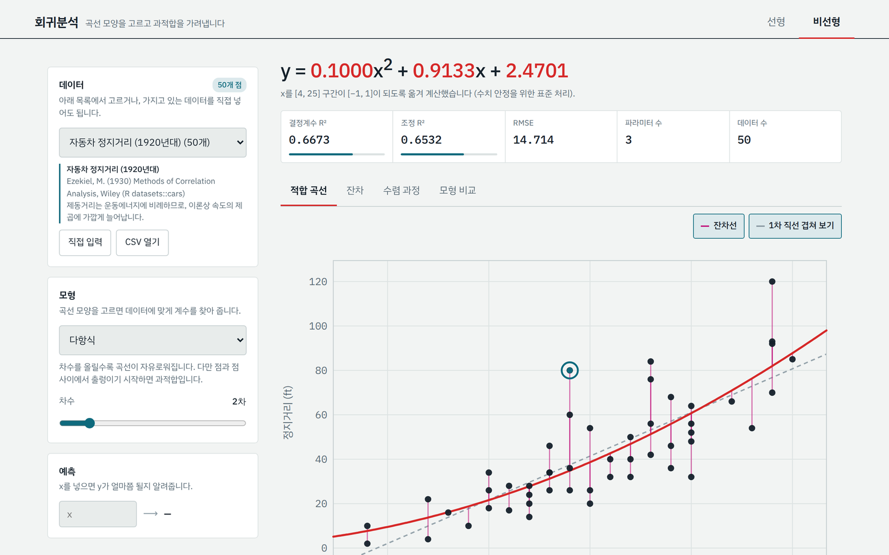
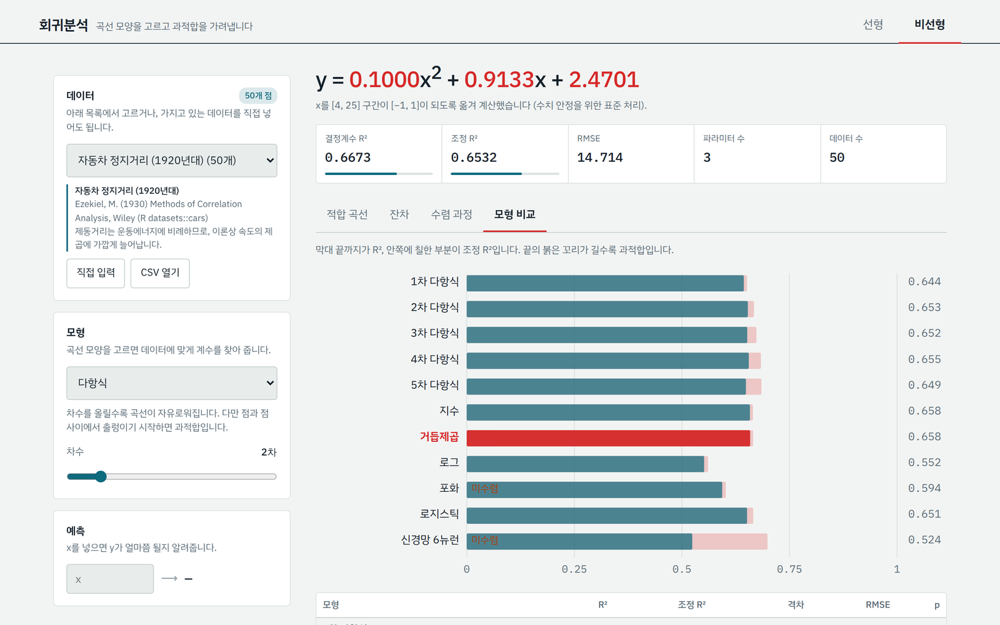

# 회귀분석과 인공신경망 프로그램

두 페이지로 되어 있습니다. 첫 화면은 회귀분석이고, 위쪽 제목 옆의 "인공신경망"을 누르면 인공신경망 페이지로 넘어갑니다. 두 페이지 모두 브라우저로 열기만 하면 되고 설치할 것은 없습니다.



## 회귀분석

**선형 모드**는 같은 직선 `y = ax + b`를 최소제곱법과 경사하강법으로 각각 구해 비교합니다. 경사하강법은 학습률과 반복 횟수를 바꿔 가며 오차가 줄어드는 과정을 볼 수 있습니다.

**비선형 모드**는 다항식(1~8차), 지수, 거듭제곱, 로그, 포화, 로지스틱, 인공신경망 가운데 곡선 모양을 골라 적합합니다.

두 모드 모두 R²와 조정 R²를 함께 보여주고, 과적합이 의심되거나 계산이 수렴하지 않으면 경고를 띄웁니다. 잔차 그래프에는 ±1 RMSE 구간을 표시하고, 점을 누르면 그 점의 값과 잔차를 확인할 수 있습니다.



모형 비교 화면은 모형마다 R²와 조정 R²를 한 막대에 겹쳐 그립니다. 막대 끝의 붉은 꼬리가 길수록 파라미터 수에 비해 데이터가 부족하다는 뜻입니다.

## 데이터 넣기

공개 데이터 6종이 들어 있고, 가지고 있는 데이터를 넣을 수도 있습니다.

- `직접 입력`: 한 줄에 x와 y를 하나씩 적습니다. 쉼표, 공백, 탭을 모두 알아봅니다.
- `CSV 열기`: 열이 여러 개인 파일이면 x와 y로 쓸 열을 고를 수 있습니다.

계산은 전부 브라우저 안에서 끝나고, 넣은 데이터는 밖으로 나가지 않습니다.

## 내장 데이터

| 데이터 | 점 수 | 출처 |
|---|---|---|
| 자동차 정지거리 (1920년대) | 50 | Ezekiel, M. (1930) Methods of Correlation Analysis, Wiley (R datasets::cars) |
| 수은 증기압 | 19 | McNeil, D. R. (1977) Interactive Data Analysis, Wiley (R datasets::pressure) |
| 미국 인구 (1790~1970) | 19 | 미국 인구조사 (R datasets::uspop) |
| 효소 반응속도 (처리군) | 12 | Treloar, M. A. (1974), R datasets::Puromycin |
| 테다소나무 성장 | 84 | R datasets::Loblolly |
| 차량 중량 대 연비 | 398 | UCI Auto MPG (seaborn-data/mpg.csv) |

## 계산 방법

| 대상 | 방법 |
|---|---|
| 최소제곱법 | `a = Σ(xᵢ−x̄)(yᵢ−ȳ) / Σ(xᵢ−x̄)²`, `b = ȳ − a·x̄` |
| 경사하강법 | x, y를 표준화해 학습한 뒤 계수를 원래 단위로 환원 |
| 다항식 | 정규방정식, x 구간을 [−1, 1]로 옮겨 수치 안정화 |
| 지수·거듭제곱·로그·포화·로지스틱 | Levenberg-Marquardt. 초기값은 지수·거듭제곱·로그는 로그 변환 후 직선화로, 포화·로지스틱은 y 최댓값과 x 평균·범위로 추정 |
| 인공신경망 | 은닉층 1개(tanh), 역전파와 모멘텀 경사하강법 |
| 조정 R² | `1 − (1 − R²)(n − 1)/(n − p)` |

## 인공신경망

회귀분석에 쓴 데이터 6종에 인공신경망을 적용하고, 같은 입력으로 구한 선형회귀와 오차(RMSE)를 비교한 결과 페이지입니다. 요약, 데이터별 결과, 분석, 계산 방법, 내 데이터로 해보기 다섯 화면으로 나뉘어 있습니다.

| 데이터 | 오차를 잰 데이터 | 선형회귀 | 신경망 | 변화 |
|---|---|---|---|---|
| 자동차 정지거리 | 시험용 10대 | 11.26 ft | 13.44 ft | +19% |
| 수은 증기압 | 학습한 19개 | 142.7 mmHg | 4.371 mmHg | −97% |
| 미국 인구 | 학습한 19개 | 17.14 백만 명 | 3.245 백만 명 | −81% |
| 효소 반응속도 | 학습한 12개 | 28.21 counts/min² | 8.515 counts/min² | −70% |
| 테다소나무 성장 | 시험용 17그루 | 3.719 ft | 2.012 ft | −46% |
| 차량 연비 (입력 3개) | 시험용 78대 | 3.689 mpg | 3.121 mpg | −15% |

6개 중 5개에서 신경망 오차가 더 작았습니다. 곡선이 뚜렷한 데이터일수록 차이가 컸고, 같은 속도에서도 정지거리가 크게 흩어지는 자동차 정지거리에서는 선형회귀가 더 정확했습니다. 점이 30개가 안 되는 데이터는 시험용을 떼지 않아서, 오차가 학습한 데이터에서 잰 값입니다.

신경망 설정: 은닉층 1개(시그모이드), 은닉 뉴런 4개(효소 반응속도는 3개), 경사하강법 3,000회, 학습률 0.3, 고정한 난수 씨앗. 점이 30개 이상이면 80%로 학습하고 20%로 시험했습니다.

## 파일 구성

```
index.html                   회귀분석 페이지
neural-network.html          인공신경망 페이지
linear_regression.py         선형회귀 파이썬 버전
shot-*.png, cover.png        화면 이미지 (README와 노션 표지용)
```

파이썬 버전 실행: `pip install numpy matplotlib` 후 `python linear_regression.py` (CSV를 쓰려면 파일 경로를 뒤에 붙입니다).

